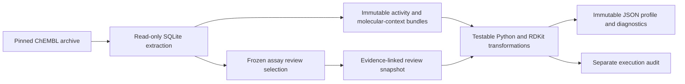

# AssayTrace

Reproducible bioactivity curation and molecular prediction, built around one
question: **How do curation choices and molecular train/test splitting strategies
affect measured predictive performance?**

The project is currently in **Phase 1: foundation and scientific feasibility**.
Pinned ChEMBL37 human acetylcholinesterase (`CHEMBL220`) IC50 records can be
profiled locally with source provenance, conservative chemistry/grouping rules,
explicit review eligibility, immutable publication and reconstruction checks.
Scientific feasibility remains inconclusive while assay review is pending.
No predictive model results are available yet.

## Run the offline tests

Prerequisites: Docker Desktop with Linux containers on Windows/WSL2. From the
repository root in PowerShell:

```powershell
docker build -t assaytrace-phase1:test .
docker run --rm --network none --mount "type=bind,source=$PWD,target=/workspace" -w /workspace assaytrace-phase1:test python -m pytest -q
```

The first build installs the locked dependencies. Tests then run offline using
explicitly authored synthetic fixtures; no ChEMBL download or account is required
for routine tests. The actual-source compatibility check is opt-in and separate.
See [local operations](docs/phase1-operations.md) for the observed Windows Docker
path, source-check command and profiling instructions.

## Current architecture



The current CLI composes saved source bundles; those local data files are ignored
by Git and are not included in a fresh clone. `config/phase1.json` identifies the
existing local checkpoint. A successful synthetic test run does not establish
source compatibility, assay eligibility or scientific feasibility.

Measurement identities retain approved stereochemical/isotopic distinctions.
Conservative equivalence/scaffold groups prevent prospective split leakage.
Source-parent conflicts quarantine allocation, while preserving measurements for
descriptive accounting when their other eligibility rules pass. Assay decisions
remain assistant-proposed until explicitly confirmed by the user.

## Evidence and project documents

- [Roadmap and approval gates](docs/project-roadmap.md)
- [Phase 1 specification](docs/superpowers/specs/2026-09-11-phase-1-foundation-feasibility-design.md)
- [Approved implementation plan](docs/superpowers/plans/2026-09-12-phase-1-implementation.md)
- [Interim scientific findings and limitations](docs/phase1-findings.md)
- [Validation evidence, TDD cycles and actual run results](docs/phase1-validation.md)
- [Profile data dictionary](docs/phase1-profile-data-dictionary.md)
- [First assay review batch](docs/reviews/phase1-batch-001.md)

PostgreSQL, Parquet, Airflow orchestration, baseline/stronger models and final
random-versus-scaffold evaluations belong to later approval-gated phases. Final
success requires defensible comparisons and reproducibility, not improved scores.

ChEMBL source licensing and attribution remain applicable to source-derived
artifacts; archive license evidence is preserved with local acquisition material.
Synthetic fixtures are explicitly labeled and dedicated to CC0 in their
[fixture documentation](tests/fixtures/README.md).
