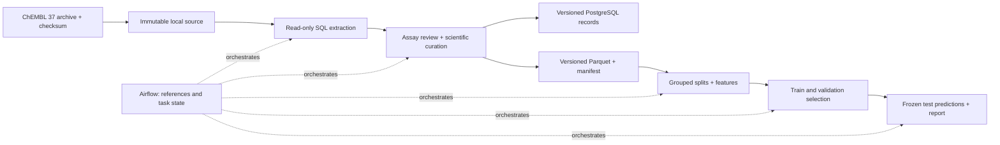

# AssayTrace Scientific and Implementation Plan

> **Historical initial proposal — not an approved implementation plan.** Added 2026-09-11 after the user approved the overall direction only. The original proposal below is retained as an evidence and design-history record. Its execution instructions, six milestones, thresholds, schemas, file lists, model settings, and approval wording are superseded as operative guidance by the [project roadmap](../../project-roadmap.md) and the phase approval workflow. They must not be executed on the basis of this document.
>
> **Evidence classification:** The original workspace inspection and bounded source-query observations in section 1 are historical observations from that session, with the sampling limitations stated there. They are not current environment checks or proof of final dataset feasibility. The target recommendation, resource budgets, eligibility/identity rules, aggregation method, numerical thresholds, model configuration, table design, and estimates are **provisional proposals**, not approved choices. Remaining **unresolved questions** include environment readiness, full eligible compound/scaffold counts, assay-review effort and compatibility, repeat-measurement coverage, and the final scientific protocol. No captured raw API response fixtures or model results are supplied by this record.
>
> **Current review material:** [Phase 1 design specification](../specs/2026-09-11-phase-1-foundation-feasibility-design.md). No phase implementation plan is authorized yet. Preserve the original text below when citing or revisiting earlier reasoning; promote a choice into an approved phase specification explicitly rather than assuming it carries forward.

> **Status: proposed; awaiting explicit user approval.** No application code, project scaffolding, dependencies, or full dataset downloads have been created. The source checks below are planning evidence, not model results.
>
> **For agentic workers:** After approval, use `superpowers:executing-plans` and `superpowers:test-driven-development` to execute the milestones in order. Use `superpowers:systematic-debugging` for unexpected behavior. Do not delegate without authorization. Checkboxes are delivery checkpoints, not permission to bypass red–green–refactor.

**Goal:** Determine how treatment of discordant bioactivity measurements and molecular splitting affect measured predictive performance, while delivering a reproducible scientific ETL system.

**Architecture:** An independently runnable Python package reads an immutable ChEMBL release, curates a target subset, publishes relational data and Parquet, and evaluates two models. Airflow orchestrates that same package in Linux containers, passing artifact references. PostgreSQL stores curated records, lineage, and publication metadata.

**Proposed stack:** Python 3.12, Apache Airflow 3.3.1, PostgreSQL 16, RDKit, scikit-learn, NumPy, pandas, PyArrow, psycopg, pytest, Docker Compose. Exact package versions, hashes, and image digests will be resolved and tested after approval, before processing the full source.

**Spec:** The user's AssayTrace brief, operationalized by sections 1–6 of this document. This is a single reviewable scientific design and delivery plan.

## Global constraints

- Workflow: planning → explicit user approval → continuous test-driven development → additional end-to-end validation.
- Preserve existing work. Inspection found an empty workspace, no Git repository, and no on-disk ancestor/project `AGENTS.md`. The user-supplied `/graphify` instruction applies; that command was not invoked.
- One pinned release, one target, one endpoint, two models, two curation policies, two split strategies.
- No result is required to be positive. Do not select targets, thresholds, seeds, or reports based on attractive test scores.
- No LLM, vector database, Kubernetes, distributed processing, frontend, or artificial daily retraining.
- Routine tests are offline; explicitly opted-in live checks and full scientific runs are separate.

## 1. Feasibility and source decision

### Observed workspace and environment

On 2026-09-11, `AssayTrace` contained no files, including hidden files. `git status` reported that it was not a Git repository. No existing code or tests were available to assess.

Git, WSL, uv 0.11.8, and an MSYS2 Python 3.11.7 executable were discoverable. Docker was absent from PATH and from the two standard Docker Desktop executable locations checked. This does not prove it is absent everywhere. RAM inspection was denied; CPU allocation and Docker/WSL readiness remain unverified. C: reported approximately 272 GB free. Do not base the project on the MSYS2 Python installation; use Linux containers for the reproducible environment.

The installed ChEMBL skill was reviewed. Its utility requires `polite_http`, which the discovered Python lacks. No dependency was installed. Browser automation reported no available browser, and the web reader could not retrieve API records. Bounded read-only PowerShell requests, with network permission, supplied the feasibility observations. This is a planning-only fallback to honor the user's no-install constraint, not the proposed application extractor. The ChEMBL licensing notification was given in the conversation; no license scaffolding was created.

### Verified source observations

The [official API status endpoint](https://www.ebi.ac.uk/chembl/api/data/status.json) reported `UP`, `ChEMBL_37`, and release date `2026-05-01`. The [official downloads page](https://chembl.gitbook.io/chembl-interface-documentation/downloads) identifies release 37 and DOI [10.6019/CHEMBL.database.37](https://doi.org/10.6019/CHEMBL.database.37).

All three target records identify a Homo sapiens SINGLE PROTEIN target. Each broad activity query used target ID, endpoint, `standard_relation='='`, `standard_units='nM'`, and `assay_type='B'`. At most 200 activity rows were returned per target across the initial, later, and filter-diagnostic requests; some were repeated. These are convenience pages, not random samples. Counts below are server-reported activity totals, not distinct or finally eligible compounds.

| Candidate | Target / accession | Endpoint | Broad activity total | First 100 rows: distinct source molecules / assays | Later 50 rows: distinct source molecules / assays |
|---|---|---|---:|---:|---:|
| Acetylcholinesterase | CHEMBL220 / P22303 | IC50 | 7,646 | 98 / 11 | 47 / 6, offset 3,800 |
| EGFR | CHEMBL203 / P00533 | IC50 | 18,381 | 100 / 4 | 18 / 5, offset 9,000 |
| Dopamine D2 receptor | CHEMBL217 / P14416 | Ki | 11,430 | 76 / 18 | 50 / 2, offset 5,700 |

Sources: [AChE query](https://www.ebi.ac.uk/chembl/api/data/activity.json?target_chembl_id=CHEMBL220&standard_type=IC50&standard_relation=%3D&standard_units=nM&assay_type=B&limit=100), [EGFR query](https://www.ebi.ac.uk/chembl/api/data/activity.json?target_chembl_id=CHEMBL203&standard_type=IC50&standard_relation=%3D&standard_units=nM&assay_type=B&limit=100), [D2 query](https://www.ebi.ac.uk/chembl/api/data/activity.json?target_chembl_id=CHEMBL217&standard_type=Ki&standard_relation=%3D&standard_units=nM&assay_type=B&limit=100). Live links can change. Observations here are a manually summarized inspection record; no original response fixture was saved or claimed.

Findings that influence the choice:

- **AChE:** all first-page values were positive and had SMILES; 12/100 carried `Outside typical range`, and 2/100 had potential-duplicate flags. The sample includes guinea-pig enzyme attached to the human target: assay CHEMBL636834 has confidence 8 and relationship H. Later assays CHEMBL3404440, CHEMBL3412979, and CHEMBL3420216 describe human enzyme inhibition with acetylthiocholine/Ellman methods and have confidence 9, relationship D, and human organism metadata. Human recombinant and erythrocyte preparations coexist and must be distinguished in provenance.
- **EGFR:** later sampled assays include L858R, T790M, double mutants, and wild type under the same target ID. A target-ID filter is insufficient to define wild-type prediction. Its higher activity count does not compensate automatically for the added biological curation work.
- **D2:** early records distinguish high/low affinity components and guanine-nucleotide conditions. Later assays include recombinant membrane binding and D2L. Ki is a legitimate separate endpoint, but isoform/state/protocol decisions add scope.
- **Metadata contradictions exist:** assay CHEMBL3420825 has human/confidence-9 metadata but describes unknown origin. CHEMBL644924 has human/confidence-9 metadata but describes eel enzyme. Contradictions must be quarantined rather than resolved by trusting one field automatically.
- **Filter failure:** adding `assay__confidence_score=9`, `assay__relationship_type=D`, and `assay__assay_tax_id=9606` to the activity endpoint still returned known confidence-8 assays and unchanged totals. These nested filters did not enforce eligibility in this check. Do not report their totals as strict counts. Direct assay endpoint filters returned matching structured fields in five inspected rows (total 1,946 assays), but even those rows revealed textual contradictions. An HTTP 200 response is not a scientific validation.

**Recommendation:** Human AChE, IC50 converted to pIC50, restricted to compatible cell-free enzyme-inhibition assays. This is a provisional target recommendation based on observed data and manageable curation, not a verified claim that the full curated dataset passes the gate below. Distinct standardized compounds, scaffold diversity, repeat-measurement coverage, and final protocol-compatible counts remain unknown until RDKit and the pinned archive are available.

### Feasibility gate and fallback

After approval, profile the entire AChE subset before training anything. Predeclared working thresholds are at least 1,000 basic-policy compounds, at least 800 concordant-policy compounds, 100 nonempty Murcko scaffold groups, and 20 source documents. Each planned split must retain at least 150 concordant test compounds and 100 concordant validation compounds; scaffold test sets need at least 20 scaffold groups. These are pragmatic portfolio thresholds, not a statistical power calculation.

Report the number of compounds with genuinely repeated measurements separately. If fewer than 50 compounds are removed by the discordance policy, retain and report the weak intervention; do not tune the cutoff to manufacture a difference. If either policy or any split fails the gate, do not search seeds until an attractive allocation appears.

Fallback order: evaluate wild-type human EGFR IC50 (CHEMBL203 / P00533), with explicit variant and cell-based assay exclusion, using the same chemical identity, numerical IC50, evaluation, and minimum-size rules. Its compatible protocol is cell-free kinase phosphorylation inhibition with identifiable substrate/readout and wild-type enzyme; record ATP concentration and incubation where available and disclose their missingness. Replace the AChE-specific protocol review, not the endpoint or human/confidence-9 requirements. Do not mix AChE and EGFR. D2 Ki remains an assessed but unselected alternative. If both IC50 candidates fail, return a feasibility report and revised proposal for approval; do not silently loosen species, confidence, or endpoint rules. Record the reason and date for any fallback before viewing model scores.

### Access, storage, and licensing

Use the official [release-37 SQLite archive directory](https://ftp.ebi.ac.uk/pub/databases/chembl/ChEMBLdb/releases/chembl_37/). The listing showed `chembl_37_sqlite.tar.gz` as approximately 5.4G compressed, versus 1.9G for the PostgreSQL archive. SQLite costs more transfer but avoids restoring the entire ChEMBL database into PostgreSQL; Python's standard library can query it read-only and extract just the target subset. Full ChEMBL PostgreSQL restore is the alternative if SQLite proves infeasible; a live API snapshot is not a substitute for a historically retrievable pinned release.

The published [SHA-256 checksums](https://ftp.ebi.ac.uk/pub/databases/chembl/ChEMBLdb/releases/chembl_37/checksums.txt) give the SQLite archive hash:

`33c203740555f96067710cdfc1c3c55d890660e5908ec5cbf5817492c290d281`

No archive was downloaded or hashed locally. Verify that checksum after download; preserve the checksum file and retrieved metadata. Reserve **60 GB free** for archive, unpacked SQLite, images, volumes, and temporary output as a conservative working budget; the actual uncompressed size has not been measured. Start with 4 allocated CPU cores and 8 GB Docker memory, subject to host verification. No GPU is required. Benchmark the full run and report actual time, memory, and storage instead of promising a duration from these samples.

The release [README](https://ftp.ebi.ac.uk/pub/databases/chembl/ChEMBLdb/releases/chembl_37/README) and [general FAQ](https://chembl.gitbook.io/chembl-interface-documentation/frequently-asked-questions/general-questions) describe CC BY-SA 3.0 data licensing. Retain IDs, release identifier, attribution, release DOI, and notices with redistributed source subsets and adapted datasets. License original project code separately (proposed MIT); do not imply that this relicenses ChEMBL data. Avoid commercial calculated descriptors; compute features with RDKit. Preserve the supplied attribution file and cite the ChEMBL paper as well as the exact release.

## 2. Data specification

### Extraction and immutable source preservation

Download to a temporary `.part` file only after implementation approval and environment checks. Stream, verify the expected SHA-256, then rename within the same filesystem. Reject absolute paths and traversal in archive members. Preserve the untouched archive, extracted read-only SQLite, source license, checksum file, release notes, schema metadata, URL, retrieval UTC time, byte count, and hashes under a release-specific directory. Never use a `latest` URL in a run manifest.

Verify the database's version metadata and required tables/columns before querying. Read-only, parameterized SQL joins target_dictionary, target_components/component_sequences, assays, activities, molecule_dictionary, compound_structures, molecule_hierarchy, docs, and source as needed. Confirm actual release schema names during the schema-contract test. Extract **all activities attached to the selected target**, not only rows that survive curation; preserve endpoint-specific exclusions and counts. An inner join must not silently discard missing structures or metadata: use explicit left joins and dispositions. Assert one output raw row per source activity ID; components and hierarchy joins must not multiply measurements.

Export source rows without overwriting published values. Preserve original `type/value/units/relation`, standardized counterparts, pChEMBL, activity comments, validity and duplicate flags, activity/assay/molecule/document IDs, source IDs, descriptions, variant information, assay organism, target mappings, and molecular structures. The archive is the ultimate original-data record; subset exports have their own schemas and hashes.

### Eligibility shared by both policies

| Concern | Rule and outcome |
|---|---|
| Target identity | CHEMBL220, SINGLE PROTEIN, target taxon 9606, component accession P22303. Reject other targets/species and multi-component ambiguities. |
| Assay mapping | Type B, confidence exactly 9, relationship D, assay taxon 9606. Missing fields are not inferred from target metadata. |
| Biological compatibility | Human wild-type AChE catalytic inhibition in cell-free purified/recombinant enzyme or erythrocyte enzyme preparations; exclude intact-cell/organism responses, reactivation, mutants, nonhuman enzyme, known irreversible/time-dependent inhibition protocols, and conflicting/insufficient descriptions. |
| Protocol | Require identifiable acetylthiocholine hydrolysis/Ellman or explicitly documented equivalent catalytic assay. Record preparation, substrate, readout, incubation, temperature/pH where available. Unknown assay method is quarantined. Variation in reported conditions remains a limitation; never claim that this makes all IC50 values intrinsic binding constants. |
| Review procedure | A versioned assay decision CSV records assay ID, accepted/excluded/quarantined, rationale, supporting description/source reference, reviewer, and date. Review metadata without compound potency or model scores. Explicit deny/uncertain cases override permissive keywords. Missing full-text access never justifies inventing conditions. |
| Endpoint | Use standardized IC50 only. Never merge Ki, EC50, Kd, percentages, or generic pChEMBL values into this label. Preserve their raw records with `wrong_endpoint`. |
| Units | Prefer ChEMBL standardized values. Convert only explicit molar concentration units M, mM, uM/µM/μM, nM, pM using a case-aware allowlist. Unknown units and mass concentrations are quarantined, not guessed. Preserve original units and conversion factor. |
| Qualifiers | Only explicit `=` is eligible for regression. Preserve `<`, `<=`, `>`, `>=`, approximate and missing qualifiers as censored/ambiguous records. No substitution of detection limits as exact labels. |
| Values | Parse decimal numbers; require finite positive values. Reject zero, negatives, NaN, infinity, malformed or missing values. Calculate pIC50 = 9 − log10(IC50 in nM). Do not clip/winsorize or impose potency cutoffs learned from the dataset. |
| ChEMBL flags | Both policies accept null validity or `Manually validated`; quarantine other validity flags. Exclude potential-duplicate=1 from modeling in both policies and retain its lineage. Null/unknown duplicate-flag values are quarantined pending schema interpretation. |
| Missingness | No imputation of target, assay, endpoint, potency, or structure. Optional experimental metadata remains explicitly missing. |

ChEMBL's [assay/activity documentation](https://chembl.gitbook.io/chembl-interface-documentation/frequently-asked-questions/chembl-data-questions) explains confidence, qualifiers, validity flags, and standardization; our additional compatibility and curation rules are project decisions. Recomputed pIC50 is cross-checked against source pChEMBL where present with tolerance 0.02 log units. A larger mismatch is quarantined for review, not silently corrected from the source pChEMBL field.

### Molecules and identity

Use a pinned RDKit release and explicitly recorded standardization parameters. Parse and sanitize source structures; reject parse failures, empty structures, query atoms, radicals, and unsupported organometallic/multicomponent cases. Restrict the modeled molecular representation to organic molecules with elements H, B, C, N, O, F, P, S, Cl, Br, I; log all exclusions. No arbitrary molecular-weight screen is added.

Remove only recognized counterions/solvents from a versioned fragment allowlist. Require exactly one remaining organic component; never silently choose the largest of two plausible active fragments. Normalize functional groups, apply deterministic neutralization where chemically possible, and retain permanent charges. Preserve source and parent mappings, transformations performed, original isomeric SMILES, and standardized isomeric SMILES. Do not merge racemates, unspecified stereo, and resolved stereoisomers into a single label. Do not tautomer-canonicalize the modeling identity in v1; this avoids quietly erasing stereochemical distinctions. These operations use the [RDKit standardization API](https://www.rdkit.org/docs/source/rdkit.Chem.MolStandardize.rdMolStandardize.html), with regression fixtures for the pinned behavior.

Two keys serve different purposes:

- `compound_id`: hash of standardization specification and canonical isomeric parent SMILES; salt forms mapped to the same standardized parent share a compound ID.
- `leakage_group_id`: a conservative, stereo-insensitive canonical-tautomer parent key used **only for partitioning**, plus union with shared ChEMBL parent IDs. This groups stereo variants and tautomer/protonation equivalents together without merging their measurements. Failures to construct a group quarantine the compound.

Compute nonchiral Bemis–Murcko scaffolds using [RDKit](https://www.rdkit.org/docs/source/rdkit.Chem.Scaffolds.MurckoScaffold.html). Scaffold partition groups are connected components linking equal scaffold keys and equal leakage-group IDs; a tautomer family cannot cross partitions merely because its scaffold representation differs. All empty scaffolds share one explicit acyclic group in scaffold splitting. Report its size and fail split-size gates if necessary; do not disguise acyclic compounds as distinct scaffolds.

### Duplicates, labels, and the two curation policies

First collapse literal repeat rows within `(release, compound, assay, document, endpoint, relation, normalized value)`, retaining all contributing activity IDs and one deterministic representative. Never infer cross-document independence from equal values; ChEMBL duplicate flags and provenance remain visible.

For remaining exact measurements, take the median pIC50 within compound–assay; then median across assays within compound–document; then median across documents for the compound label. This gives documents equal weight and avoids repeated rows or numerous assays in one paper dominating a label. Report measurement, assay, and document counts, range, median absolute deviation, and preparation distribution. Repeated measurements are not independent training rows.

- **Basic policy:** retain all compounds with at least one measurement passing the shared rules and use the hierarchical median label.
- **Concordant policy:** apply the same label calculation but exclude compounds whose range across distinct eligible measurements is **greater than 1.0 pIC50 unit**. Exactly 1.0 is retained. This is a predeclared 10-fold disagreement threshold, not a learned optimum. Singletons remain eligible, flagged as having no repeat-based agreement evidence.

This isolates one curation choice. No claim is made that disagreement proves measurement error; it can reflect real assay conditions. Excluding discrepant compounds can narrow chemical or potency coverage and reduce training size. All contributing records stay in the relational store. The comparison does not separately test unit cleaning, stereochemistry handling, or every possible curation policy.

### Table grains, keys, and relationships

All source identifiers are release-qualified. Foreign keys enforce lineage. Scientific tables are in a dedicated AssayTrace database; Airflow metadata uses a separate database and user in the same local PostgreSQL instance.

| Table | Grain / primary key | Main relationships and content |
|---|---|---|
| source_release | One verified archive / `source_id` (release + archive hash) | Release number, DOI, URL, expected/actual hash, license, schema version |
| source_target | One target per source / `(source_id,target_id)` | Taxon, type, component accessions |
| source_document | One document per source / `(source_id,document_id)` | DOI, year, source; missing source document stays nullable in raw data |
| source_assay | One assay per source / `(source_id,assay_id)` | Target FK, document FK where known, confidence, organism, variant, description |
| source_molecule | One molecule per source / `(source_id,molecule_id)` | Original structure, ChEMBL parent, molecule type |
| raw_activity | One source activity / `(source_id,activity_id)` | Assay/molecule FKs, original and standardized measurements, flags, raw payload |
| compound | One standardized identity / `compound_id` | Standardizer version, isomeric SMILES, leakage and scaffold keys |
| molecule_mapping | One source molecule per standardization spec / `(source_id,molecule_id,standardizer_id)` | Compound FK or failed status; audit of structural changes |
| curation_decision | One entity/rule decision / `(dataset_id,entity_kind,entity_key,rule_code)` | Status, primary reason order, all reasons, review evidence; links validated to source entities |
| compound_label | One compound per dataset and policy / `(dataset_id,policy,compound_id)` | pIC50, dispersion, counts, accepted/excluded status |
| label_activity | One contributing measurement per label / `(dataset_id,policy,compound_id,activity_id)` | Raw-activity FK with source_id, aggregation role, duplicate disposition |
| dataset_version | One immutable curated specification / `dataset_id` | Source/spec/code/environment hashes, publication state, manifest URI |
| split_assignment | One compound per split / `(split_id,compound_id)` | Dataset FK, strategy, seed, train/validation/test, grouping keys |
| experiment | One model fit / `experiment_id` | Dataset/split/policy, model parameters, training IDs hash, environment, status |
| prediction | One scored compound per model and partition / `(experiment_id,partition,compound_id)` | Frozen reference label, prediction, cohort, residual |
| run_attempt | One orchestration attempt / `attempt_id` | Stable logical run key, task state, artifact references, failure details |

Normalized source tables retain their fields; `raw_payload` is supporting evidence, not a replacement for queryable columns. Dataset exports have one row per `(dataset_id,policy,compound_id)` and a separate lineage Parquet, with an explicit schema and stable sort order.

`dataset_id` is SHA-256 over canonical JSON containing source archive hash, selection spec, assay-review file hash, standardization/aggregation/policy/schema versions, transform-code revision, and environment lock hash. A human label such as `chembl37-ache-ic50-v1` is descriptive, not identity. New scientific rules, source bytes, or processing environments produce a new ID. Execution timestamps and retry numbers do not. `split_id` additionally hashes split algorithm, groups, and seed; `experiment_id` additionally hashes feature/model specifications and training/validation membership. Preserve prior versions; no in-place re-curation.

## 3. Scientific evaluation protocol

### Task, models, and metrics

Predict compound-level **pIC50 for the defined assay population**, not clinical efficacy, mechanism, or universal binding affinity.

- Baseline: training-median `DummyRegressor(strategy='median')`, recalculated separately for each training population. It establishes whether structure-based predictions beat a constant under the primary loss.
- Stronger candidate: RandomForestRegressor on RDKit Morgan fingerprints (radius 2, 2,048 bits, chirality enabled). It is called a candidate because superior performance is not guaranteed. Use 300 trees, `max_features=0.33`, squared-error tree criterion, and validation-select `min_samples_leaf` from `{1,5,10}`. Fixed seed, `n_jobs=1` for reproducibility; parallelize neither models nor Airflow tasks initially.
- Primary metric: MAE in pIC50 units. Secondary: RMSE, R², and Spearman correlation. Undefined R²/correlation is reported as unavailable with a reason, not converted to zero. Report count, label distribution, and error distribution alongside every metric. One log unit corresponds to a factor of ten in concentration, not ten-percent error.

Feature generation is deterministic and unlearned. No scaling, imputation, feature selection, or target clipping is needed for v1. If later introduced, learned preprocessing must live inside a pipeline fitted only on training rows, including during model selection. No assay IDs, source potency, pChEMBL, or document identifiers enter features. Official model references: [DummyRegressor](https://scikit-learn.org/stable/modules/generated/sklearn.dummy.DummyRegressor.html), [RandomForestRegressor](https://scikit-learn.org/stable/modules/generated/sklearn.ensemble.RandomForestRegressor.html).

### Partitions and model selection

Use three predeclared seeds: **17, 42, 101**. For each seed, build independent random-group and scaffold-group assignments over the basic-policy union, before applying the discordance policy. Aim for 70/15/15 train/validation/test compound counts. Random splitting shuffles leakage groups deterministically; scaffold splitting shuffles scaffold-linked groups deterministically and assigns whole groups to approximate those fractions. Group integrity takes precedence over exact fractions; actual sizes are recorded. Fix algorithm and tie-breaking in tests; never use labels to balance or reshuffle partitions.

Apply the concordance rule independently inside each assigned partition; no compound or leakage group can span partitions. Compute validation and test reference labels with the concordant-policy formula and freeze them once. Metadata review and numerical rules are fixed before experiments; global label distributions must not be used to adjust the rules after test membership is visible.

Within each strategy and seed, both policies use the **same concordant validation set** for hyperparameter selection. Select by validation MAE, break ties by the larger minimum leaf size, then refit the chosen model on that policy's train + validation eligible compounds. The baseline uses that same final fitting population. Only then score the untouched test set. Persist selected parameters and model hashes before scoring. Test results do not trigger retuning, seed replacement, fallback target selection, or rule changes. Changes prompted by test inspection are labeled exploratory and require a new evaluation protocol.

The complete planned evaluation is **2 policies × 2 strategies × 2 models × 3 seeds = 24 final fits**; only the 12 forest cells require three candidate validation fits each. No additional model sweep, nested search, or target leaderboard.

### Common populations and interpretation

| Comparison | Evaluation population | Interpretation |
|---|---|---|
| Basic versus concordant curation, within one strategy/seed/model | Identical concordant held-out compounds, identical labels | Paired effect of removing discordant training data, including its change in training size/composition |
| Baseline versus forest, within one strategy/seed/policy | Same concordant held-out compounds and labels | Added predictive value of the chosen molecular representation/model |
| Random versus scaffold splitting | Each strategy's own predeclared test set | Difference under two evaluation protocols; not a paired causal split effect because populations differ |
| Secondary coverage/error analysis | Basic-only discordant held-out compounds, kept separate | Predictions from both models where labels are less concordant; not a replacement for the primary table |

Report a flow table from raw activities to eligible measurements, distinct compounds, concordant compounds, and each partition. Include exclusion counts, repeated-measurement coverage, scaffold counts, document overlap, preparation distribution, pIC50 distribution, and fingerprint nearest-training similarity. Show basic/concordant training sizes and test-population overlap for random versus scaffold splits. Never present the basic model on a broad test population and the concordant model on a narrow one as evidence of improvement.

The paired curation comparison estimates a practical policy change, not a pure denoising effect independent of sample size. A matched-size ablation is out of v1 scope and cannot be claimed. Concordant test labels are a more restricted reference population, not ground truth. Keep the same singletons in both test populations and disclose their prevalence.

Scaffold splitting measures prediction on held-out scaffold groups under the chosen representation. It does not guarantee unrelated chemistry, chronology, independent laboratories, or prospective drug-discovery performance. Close analogues can cross different scaffolds; identical generic rings can group diverse molecules. Random splits also retain series/document dependence. Shared publications are reported as dependence, not claimed to be eliminated. Use nearest-neighbor similarity to make the remaining structural overlap visible. Scaffold handling follows a documented project algorithm rather than a claim of a universal standard.

### Uncertainty

Publish all three seed results and their mean/range. Within each run, obtain 95% percentile intervals with 1,000 deterministic bootstrap resamples of test **scaffold-linked groups**, using identical resamples for paired model/curation differences. Maintain prediction pairs and all compounds within a sampled group. With fewer than 20 test groups, mark intervals unavailable; report the fraction of degenerate bootstrap replicates and do not manufacture finite R²/correlation intervals from them. These intervals are conditional on a fitted model and the observed dataset; seed variation measures partition sensitivity separately. Do not pool overlapping seed test sets as independent observations, treat bootstrap replicates as new experiments, or equate an interval with experimental measurement uncertainty.

## 4. Architecture and orchestration



Recommend two manually triggered DAGs rather than one DAG that retrains whenever extraction is retried:

1. `assaytrace_release`: `validate_request → acquire_verified_source → extract_target → curate → validate_dataset → stage_files_and_load_rows → publish_dataset`.
2. `assaytrace_evaluate`: `validate_published_dataset → assign_splits → build_features → fit_and_select → freeze_models → evaluate_tests → validate_report → publish_report`.

Both use `schedule=None`, `catchup=False`, and `max_active_runs=1`. Trigger the evaluation DAG explicitly with a published dataset ID and the frozen experiment specification. The fitting task loops through the small experiment matrix; avoid a large dynamic task graph. All scientific work lives in ordinary Python functions callable by a CLI and tests; DAG files only declare dependencies, parameters, and task adapters. DAG import must perform no network calls, database queries, or model fitting.

Use Docker Compose with a pinned custom Airflow image for API server, scheduler/LocalExecutor, and DAG processor; a one-shot init service performs metadata migration; one PostgreSQL service hosts separate Airflow and AssayTrace databases/users. No Celery, Redis, Docker socket mount, or extra web application. LocalExecutor parallelism starts at 1 with a one-slot science pool. A CLI/test service uses the same image and package. Shared Linux named volumes hold artifacts and PostgreSQL data; bind mounts provide source/config where needed. Document PowerShell commands and CRLF/path considerations.

This is a local demonstration deployment. [Airflow supports Windows through WSL2 or Linux containers](https://airflow.apache.org/docs/apache-airflow/stable/installation/prerequisites.html), and [LocalExecutor runs processes locally](https://airflow.apache.org/docs/apache-airflow/stable/core-concepts/executor/local.html). The [official Compose guide](https://airflow.apache.org/docs/apache-airflow/stable/howto/docker-compose/index.html) is a reference, not an instruction to import every service. Verify image compatibility and resource use in M1. Keep ports local and credentials out of source control.

### Reliability contract

- **Task inputs/outputs:** JSON references containing artifact URI/path, SHA-256, schema version, row count, and logical ID. XCom contains no DataFrames, molecule objects, trained estimators, or full datasets.
- **Idempotency:** stable logical IDs, immutable artifact paths, database unique constraints, and transactions. A repeated key with identical content is a no-op; the same key with different content is an error. Never overwrite disagreements with `ON CONFLICT DO NOTHING` without hash verification.
- **Retries:** bounded exponential backoff for transient HTTP 429/5xx, timeouts, and transient database connectivity (three retries, 30-second initial delay, five-minute cap; honor Retry-After within the cap). Invalid checksum, schema mismatch, incompatible configuration, or scientific validation failures fail without blind retry. Validation failures preserve diagnostics.
- **Partial recovery:** incomplete downloads remain unpublished; restart or safely resume only against verified remote identity. Completed extraction/curation artifacts are reused only after hash and schema validation. A failed training/report step does not rerun extraction. Temporary leftovers may be reclaimed only when not referenced by a running attempt.
- **Atomic publication:** write files to temporary locations, fsync/close, verify, and rename to immutable locations on the same volume. Load versioned SQL rows in a transaction as staging. A final database transaction marks the dataset published and stores the complete manifest hash/URI. Consumers query only published IDs and verify the manifest. Filesystem and database do not share a distributed transaction: orphan files or staging rows can exist after a crash, but no incomplete dataset becomes visible through the publication catalog. The report uses the same protocol.
- **Concurrency:** acquire an advisory lock on the logical dataset/experiment key, in addition to DAG concurrency limits, because the CLI can run independently. On retry after a successful commit but lost acknowledgment, verify and return the published ID without duplicating rows.
- **Reruns:** same release/spec/environment reproduces dataset/split IDs, stable logical row hashes, and predictions within declared tolerances. Timestamps/logs differ and are excluded from content identity. Parquet byte hashes are integrity checks; logical table hashes define reproducibility when metadata encoding differs.
- **New releases:** explicit configuration change, new source and dataset IDs, schema/feasibility checks, fresh split/model/report artifacts, and a release-diff report. Never auto-poll `latest`, mutate the old dataset, or present a newly ingested release as a retry.

### Minimal dependencies and responsibilities

SQLite is a standard-library source reader, not another server. PyArrow provides typed Parquet; psycopg provides PostgreSQL transactions/COPY; pandas handles the modest target subset; NumPy and scikit-learn provide numerical/model operations; RDKit provides chemical identity/features. Use stdlib argparse, logging, JSON, hashlib, urllib, sqlite3, and SQL migration files where sufficient. Matplotlib is the only proposed reporting addition, justified by exportable curation/error plots. No MLflow, DVC, Great Expectations, ORM, or API framework is needed; manifests, SQL constraints, and pytest cover this scope.

## 5. Tests, validation, and definition of done

### Continuous test workflow

For each behavior, write an acceptance-derived test, run it and inspect the intended failure, implement the smallest passing behavior, run related tests, and refactor with tests green. Record the failing command/reason and passing command in the development log. Syntax errors, missing third-party packages, a stopped database, or an unrelated import failure do not establish a meaningful red test. A minimal importable interface may raise `NotImplementedError` so the requirement can fail at the intended behavior. No successful test runs are claimed in this planning phase.

Example assertions to implement after approval, using a proposed public conversion interface:

```python
@pytest.mark.parametrize('value,unit,expected', [('1','nM',9), ('1','uM',6), ('100','nM',7)])
def test_exact_ic50_has_molar_negative_log(value, unit, expected):
    assert to_pic50(value, unit, '=') == pytest.approx(expected)

def test_censored_ic50_is_not_an_exact_regression_label():
    with pytest.raises(IneligibleMeasurement, match='censored'):
        to_pic50('100', 'nM', '>')

def test_concordance_threshold_is_inclusive():
    assert is_concordant([6.0, 7.0]) is True
    assert is_concordant([6.0, 7.0001]) is False
```

### Requirement-to-test map

| Requirement | Meaningful tests / expected evidence |
|---|---|
| Pinned extraction | Synthetic miniature SQLite with version/table mismatch; wrong archive SHA; traversal member rejection; missing required columns; target join with multiple components cannot inflate counts; preserve records with missing joins. |
| Download recovery | Local HTTP fixture server returns partial body, timeout, 429/5xx, changed ETag and final success; no publication on truncation; corrupt cache rejected. No public source used by routine tests. |
| Scientific eligibility | Nonhuman assay attached to human target; confidence 8; missing organism; mutation; eel/human description conflict; reactivation and intact-cell response; permitted biochemical preparation; API-style ignored-filter payload cannot bypass local validation. |
| Units/qualifiers | 1 nM→9, 1 uM→6, 100 nM→7; micro-symbol variants; pM and M; case mismatch, mass units, blank/approximate inequality; zero, negatives, infinity/NaN and invalid text; pChEMBL mismatch. |
| Chemical identity | Same salt/parent and equivalent SMILES map consistently; two active fragments quarantined; stereo identities remain distinct but share leakage group; tautomers grouped for partitioning; permanent charges retained; invalid and unsupported structures excluded; no silent stereo loss. |
| Duplicates/conflicts | Repeating a row does not shift labels; distinct sources keep lineage; assay→document→compound medians use equal document weight; potential duplicates excluded; exactly 1.0 retained and greater than 1.0 excluded; singleton flagged. |
| SQL/provenance | Real temporary PostgreSQL load, FK and unique constraints, expected row counts, all labels traceable to source IDs; Parquet round-trip types/nulls; staging hidden; rollback on malformed row. |
| Split leakage | No compound, parent-equivalence, or leakage group overlaps; no scaffold-linked group overlap for scaffold split; stereo/tautomer/salt adversarial fixtures; acyclic group kept intact; changing input row order preserves assignment. |
| Evaluation isolation | Test-only extreme labels cannot change fitted baseline, parameters, or predictions; validation labels can influence selection; test IDs absent from all fits; common curation test IDs/labels identical; metric examples computed by hand; bootstrap keeps paired predictions/groups. |
| Reproducibility | Two fresh executions produce identical logical dataset hashes, group/split assignments, and row counts; fixed-environment numerical predictions/metrics agree within 1e-8 absolute tolerance. Changed source/spec/seed produces the relevant new IDs. |
| Airflow | DagBag/import validation, zero import errors or parse-time I/O, correct upstream dependencies/parameters, schedule absent, retries only where intended, references in XCom, and tasks invoking the same tested package. |
| Failure recovery | Interrupt after file staging, during SQL load, after publication commit, and before report publication; recover without duplicate rows or broken manifests; previous published version remains readable; CLI/DAG concurrent same-key attempts converge. |
| End-to-end | A small synthetic archive through both DAGs and real PostgreSQL/Parquet/feature/model/report steps; then an opt-in small captured ChEMBL subset; finally the approved full target analysis on the pinned release. |

Synthetic fixtures are authored independently, explicitly marked synthetic, and redistributable under the project test-fixture license. They include human-readable expected outcomes, not invented claims of captured ChEMBL payloads. Captured fixtures, if added after approval, are small unchanged source extracts with retrieval URL/time, release, checksum, IDs, and CC BY-SA notices; derived expected outputs are stored separately. Molecular examples in synthetic tests are not asserted bioactivity observations.

### Measurable acceptance

- All required unit, integration, DAG, leakage, and failure-recovery tests pass in a clean pinned container environment. A failed required test blocks publication.
- Every extracted activity has exactly one terminal disposition per curation policy, plus zero or more reason codes; counts reconcile to extraction. Every published label has source lineage; zero orphan FKs or duplicate logical keys.
- Zero cross-partition compound/leakage-group overlaps; zero scaffold-linked group overlaps for scaffold splits. All 24 primary result cells use their prescribed populations; non-estimable metrics are explicit.
- Rerunning a logical ingestion does not change row counts or create another dataset version. Killing/retrying each publication boundary exposes no incomplete dataset.
- Fresh reruns satisfy the numerical and content reproducibility contract. Report differences rather than relax tolerances silently.
- Routine offline suite target: under five minutes; small Compose end-to-end target: under ten minutes on the documented reference machine, excluding first image build. Measure before promising these targets. Full scientific runtime and resource use are recorded; no predictive-score minimum is required.
- Full target data passes the declared feasibility gate, or the approved fallback is used with a documented scientific rationale. A blocked/negative feasibility outcome is reported honestly rather than relabeled a completed modeling result.
- README includes PowerShell setup, offline demo, pinned-source acquisition, full run, rerun/recovery, SQL queries, report locations, resource expectations, and safe teardown. Data deletion requires an explicit destructive command, not routine shutdown.
- Portfolio artifacts: architecture diagram, data dictionary with grains/nullability/keys, versioned modeling data plus lineage/manifests, curation flow/report, all evaluation results and predictions, reproducibility log, and limitations. The limitations explicitly cover assay heterogeneity, source errors, selection/censoring bias, singleton uncertainty, scaffold limitations, shared-publication dependence, and single-target generalizability.

## 6. Delivery milestones and file responsibilities

These are scoped estimates of focused work, not deadlines: approximately 12–18 working days overall, with assay review and environment readiness the largest uncertainties. Do not expand the scientific matrix to fill time.

### M1 — Minimal vertical slice (2–3 days)

**Deliverable:** One small synthetic source travels through source verification, extraction, minimal exact-value curation, PostgreSQL, Parquet, a grouped random split, median baseline, and a clearly marked synthetic report. Both thin DAGs can orchestrate it. This proves the full route before extensive chemistry or full source work.

**Files to create after approval:** `pyproject.toml`, dependency lock, `Dockerfile`, `compose.yaml`, `.env.example`, `.gitignore`; `src/assaytrace/{contracts,source,extract,measurements,storage,artifacts,cli}.py`; `src/assaytrace/modeling/{splits,train,evaluate}.py`; `sql/001_initial.sql`; `dags/{assaytrace_release,assaytrace_evaluate}.py`; `tests/fixtures/synthetic/`, `tests/unit/test_measurements.py`, `tests/integration/test_vertical_slice.py`, `tests/dags/test_dags.py`, `README.md`.

**Interfaces:** source verification yields a manifest reference; extraction yields typed source tables; conversion yields pIC50 or a reasoned ineligibility error; loading accepts versioned tables; publication returns a dataset ID; model evaluation consumes a dataset/split reference and returns report/prediction references. Shared JSON artifact references contain `uri`, `sha256`, `schema_version`, `row_count`, and `logical_id`.

- [ ] Verify Docker Desktop/WSL readiness and resources; resolve pinned versions and hashes, then initialize Git and the minimal test environment after approval. Do not install system software silently.
- [ ] Write the conversion and source-integrity tests; run `python -m pytest tests/unit/test_measurements.py -q` and the source tests to confirm the intended red conditions.
- [ ] Implement each behavior minimally and rerun its test before moving to the next behavior; refactor with those tests passing.
- [ ] Write failing real-storage round-trip and small-report acceptance tests, then implement transactional loading, artifact references, minimal baseline evaluation, and thin task adapters.
- [ ] Run `python -m pytest tests/integration/test_vertical_slice.py tests/dags/test_dags.py -q` in the Compose test service, then trigger both DAGs on the synthetic fixture.

**Acceptance/tests:** small run publishes traceable rows, deterministic baseline predictions, and a synthetic-labeled report; both DAGs parse and run; no network is required after images are available. Minimal acceptance assertions precede the production behavior. **Dependencies/risks:** Docker readiness, image/library compatibility, container memory, and source-schema fixtures.

### M2 — Pinned source and feasibility gate (2–3 days)

**Deliverable:** Verified ChEMBL 37 acquisition, target-only raw relational export, metadata review, eligibility flow, and a recorded target go/no-go decision before modeling.

**Files:** extend `source.py`, `extract.py`, `sql/001_initial.sql` through a new SQL migration; create `config/source.json`, `config/selection.json`, `config/assay_review.csv`, `src/assaytrace/assays.py`, `tests/unit/test_assays.py`, `tests/integration/test_extraction.py`, `tests/live/test_chembl_contract.py`, `docs/feasibility.md`, data license/attribution files.

- [ ] Test wrong release/checksum/schema, joined-row multiplication, missing structures, nonhuman and contradictory assay records; inspect each intended failure.
- [ ] Implement extraction and eligibility contracts incrementally; demonstrate the formerly excluded counterexamples cannot pass; rerun offline tests.
- [ ] Download the one archive only after resource checks, validate checksum/version, and extract the target subset. Preserve immutable raw artifacts.
- [ ] Review assay metadata without model outcomes; integrate the identity profile from M3 to evaluate compound/scaffold gates, then freeze the target decision and assay review file.

**Acceptance/tests:** raw counts reconcile; all requested predicates are locally enforced; report distinguishes activities, source molecules, standardized compounds, and scaffolds. **Dependencies/risks:** M1, source transfer/storage, incomplete descriptions, unsupported confidence filters. M2's final gate depends on M3's tested identity functions; model fitting waits for both milestones.

### M3 — Chemical curation and versioned datasets (3–4 days)

**Deliverable:** Both agreed curation policies, standardized identities and conservative leakage groups, versioned SQL/Parquet, and a complete data dictionary and curation report.

**Files:** `src/assaytrace/{chemistry,curation,labels,provenance}.py`, `config/standardization.json`, `config/curation.json`, `sql/002_curation.sql`, `tests/unit/{test_chemistry,test_labels,test_curation}.py`, `tests/integration/test_lineage.py`, `docs/{data_dictionary,curation_policy}.md`.

- [ ] Write adversarial salt/stereo/tautomer/mixture tests and observe intended failures; implement identities and grouping with pinned RDKit parameters.
- [ ] Test within-assay/document aggregation, repeat-row invariance, singleton flags, and both sides of the conflict boundary before implementing labels.
- [ ] Test disposition conservation and complete lineage; implement both policy exports, content IDs, and curation report; rerun chemistry/SQL/Parquet checks and refactor.
- [ ] Complete M2's feasibility gate with these tested transformations; freeze the dataset manifest before M4.

**Acceptance/tests:** all identity, aggregation, lineage, and row-accounting requirements pass; one row per compound/policy; exclusions remain inspectable. **Dependencies/risks:** M2 raw extraction, missing structures, ambiguous chemistry, large attrition, and assay-review workload.

### M4 — Leakage-controlled evaluation (2–3 days)

**Deliverable:** Frozen splits, the 24-cell evaluation, paired curation/model comparisons, uncertainty, and coverage diagnostics.

**Files:** extend `modeling/splits.py`, `train.py`, `evaluate.py`; create `modeling/{features,bootstrap}.py`, `config/experiments.json`, `tests/unit/{test_splits,test_features,test_metrics,test_bootstrap}.py`, `tests/integration/{test_no_leakage,test_model_selection}.py`, `docs/evaluation_protocol.md`.

- [ ] Test group overlap, acyclic handling, shuffled-input determinism, and seed/version semantics before adding split logic.
- [ ] Test train-only fitting with adversarial held-out labels, common test membership, and explicit validation selection before adding forest fitting.
- [ ] Test hand-computed metrics and paired group resampling; implement uncertainty and reporting; rerun relevant tests and refactor.
- [ ] Freeze experiment configuration and selected-model artifacts; score the held-out data once for the planned report and preserve all results, including negative R² or failure to beat the baseline.

**Acceptance/tests:** no leakage invariant violated; model selection cannot read test labels; uncertainty and population diagnostics accompany every score. **Dependencies/risks:** M2/M3 feasibility, imbalanced scaffold groups, few repeated measurements, residual assay dependence.

### M5 — Recovery and reproducible reruns (2 days)

**Deliverable:** Both DAGs and CLI recover safely at each publication boundary and converge on the same logical outputs.

**Files:** extend `artifacts.py`, `storage.py`, source retry handling and DAG adapters; `tests/integration/{test_recovery,test_idempotency,test_concurrency}.py`, `tests/e2e/test_airflow_run.py`, `docs/operations.md`.

- [ ] Inject failures before/after file publication and database commits, assert no partial visibility or duplicate logical rows, and confirm red before adding recovery paths.
- [ ] Implement bounded transient retries, advisory locking, manifest verification, and acknowledgment-loss recovery; rerun affected tests and refactor.
- [ ] Repeat the fixture pipeline through CLI and Airflow, including a competing same-key attempt and a fresh database restore/reload; compare logical hashes and predictions.

**Acceptance/tests:** all failure cases preserve the previous published dataset and recover deterministically; XCom remains small references. **Dependencies/risks:** M1–M4, filesystem/database atomicity boundary, stale artifacts, Airflow-specific behavior.

### M6 — Final acceptance and portfolio delivery (1–3 days)

**Deliverable:** Reproducible local setup, clean-machine instructions, architecture/data dictionary, actual curation and evaluation reports, provenance, limitations, and recorded end-to-end evidence.

**Files:** `docs/{architecture,limitations,reproducibility}.md`, report generator and generated `reports/<experiment-set-id>/` artifacts, final README, `tests/e2e/test_acceptance.py`, optional small CI workflow for the offline/unit and service-integration suites only.

- [ ] Add acceptance assertions for missing report cells, provenance links, misleading synthetic labels, and metric/count consistency before final report behavior.
- [ ] Run the complete required offline/integration suite and small DAG end-to-end run; record commands, environment, and actual outcomes.
- [ ] Run the full approved target analysis through Airflow; repeat from the same pinned artifacts with fresh output/catalog state and verify the reproducibility contract without deleting the first result.
- [ ] Audit the reports against manifests and SQL; ensure exclusions, weak/negative results, feasibility changes, resource use, and scientific limits are visible.

**Acceptance/tests:** all definition-of-done items pass and a reader can reproduce the small demo plus full analysis from documented commands. **Dependencies/risks:** all earlier milestones; numerical drift, undocumented manual steps, hardware constraints. A polished UI is not an acceptance requirement.

## Out of scope

Multiple targets/endpoints, chronological or document-held-out benchmark expansion, censor-aware regression, uncertainty-calibrated molecular models, matched-size curation ablations, neural networks/GNNs, docking, external validation datasets, clinical claims, automated full-text assay interpretation, LLM features, cloud deployment, Kubernetes, Spark/distributed training, Redis/Celery, vector search, a prediction API, frontend work, and automated daily retraining.

## Approval boundary

Approve or revise this scientific protocol and architecture before development starts. Approval authorizes the staged implementation and tests; any target fallback follows the predeclared gate, while changing endpoints, relaxing scientific eligibility, or expanding the experiment matrix requires a revised proposal. System installations and any tool-required privileged actions remain explicit when encountered. This pause follows the user's mandatory workflow; it is not an additional approval gate invented by a skill.
